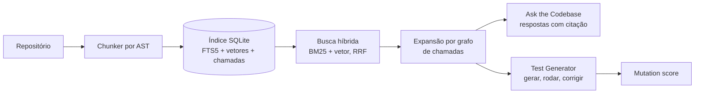

# LegacyLens

Ferramenta de linha de comando e API para duas tarefas que travam quem entra em um código legado: **achar onde as coisas acontecem** e **conseguir testes para mexer com segurança**. Os dois recursos usam o mesmo índice do repositório.

- **Ask the Codebase**: responde perguntas como "onde é feita a validação de pagamento?" citando `arquivo:linha`. Se os trechos recuperados não bastam, diz que não sabe.
- **Test Generator**: gera testes `pytest` para uma função, roda, lê o erro, corrige e só entrega o que passa e de fato verifica algo.

> **Status:** projeto de portfólio, versão 0.1. A base está testada (`pytest`), mas os números de ganho ainda dependem de rodar a avaliação em um repositório real. A tabela de resultados abaixo está em branco de propósito até eu ter esses números. Veja [docs/evaluation.md](docs/evaluation.md).

## Por que fiz isso

Quando entro em um sistema antigo, perco as primeiras semanas descobrindo onde está cada regra e o que quebra se eu mexer. E o que me daria confiança para mexer, os testes, é justamente o que falta, porque ninguém escreve teste para código que não entende.

A maioria dos demos de RAG é "converse com um PDF". Código é um material bem diferente: o que importa está nos identificadores exatos, na estrutura e em quem chama quem. Quis construir algo que tratasse isso de frente e que eu pudesse **medir**, em vez de só mostrar uma demo bonita.

## Como funciona



1. **Chunking por AST.** Cada função e método vira um chunk; classes viram um cabeçalho. Nada é cortado no meio de uma função.
2. **Busca híbrida.** BM25 (SQLite FTS5) pega identificadores exatos, vetores pegam a intenção, e os dois rankings são fundidos por Reciprocal Rank Fusion. Um reranker leve favorece chunks cujo nome aparece na pergunta.
3. **Contexto estrutural.** Para os melhores resultados, trago também quem eles chamam e quem os chama. Esses vizinhos vêm marcados como `graph`.
4. **Respostas ancoradas.** O prompt exige citação no formato `[caminho:inicio-fim]`. Depois da resposta, cada citação é conferida contra os trechos que realmente foram enviados; as que não batem são reportadas como inválidas.
5. **Testes com execução.** O modelo escreve o teste, o `pytest` roda, a saída do erro volta para o modelo (até N tentativas). Testes sem nenhum `assert` são rejeitados antes de rodar, e nenhum arquivo que falha fica no repositório.

Detalhes e trade-offs em [docs/architecture.md](docs/architecture.md) e [docs/decisions.md](docs/decisions.md).

## Como rodar

Requisitos: Python 3.10+ e uma chave da API da Anthropic (`ANTHROPIC_API_KEY`) para `ask` e `testgen`. `index`, `search` e `eval` de recuperação funcionam sem chave.

```bash
pip install -e ".[dev]"

legacylens index /caminho/do/repositorio
legacylens search "validação de pagamento" -k 5          # só recuperação, sem LLM
legacylens ask "onde validate_payment valida o cartão?"
legacylens testgen "app/payments.py::PaymentService.fee" --mutation
```

Com Docker (indexa na subida e expõe a API em `:8000`):

```bash
REPO=/caminho/do/repositorio ANTHROPIC_API_KEY=... docker compose up
curl -s localhost:8000/ask -H 'content-type: application/json' \
     -d '{"question": "onde validate_payment valida o cartão?"}'
```

Configuração por variáveis de ambiente (`LEGACYLENS_MODEL`, `LEGACYLENS_EMBEDDER`, `LEGACYLENS_PRICE_IN`/`_OUT` para custo, etc.) em [`config.py`](src/legacylens/config.py).

### Embeddings

O padrão é um embedder por hashing: roda offline e sem dependências, mas **não entende semântica nem português vs. inglês**. Serve para CI e testes. Para uso de verdade:

```bash
pip install -e ".[semantic]"
LEGACYLENS_EMBEDDER=st:BAAI/bge-small-en-v1.5 legacylens index .
```

## Resultados

Linha de base e metodologia em [docs/evaluation.md](docs/evaluation.md). Repositório avaliado: **a definir** (commit fixo, anotado aqui).

| Métrica | Valor |
|---|---|
| recall@5, só BM25 | a medir |
| recall@5, só vetor | a medir |
| recall@5, híbrido | a medir |
| recall@5, híbrido + grafo | a medir |
| Citação correta nas respostas | a medir |
| Abstenção correta (pergunta sem resposta) | a medir |
| Testes que passam de primeira | a medir |
| Mutation score: gerados vs. escritos por humanos | a medir |
| Custo e latência por consulta | a medir (`.legacylens/telemetry.jsonl`) |

Vou publicar os números como saírem, inclusive onde o sistema erra.

## Limitações conhecidas

As principais, resumidas (lista completa em [docs/limitations.md](docs/limitations.md)):

- Só Python por enquanto. O chunker usa o módulo `ast` da biblioteca padrão; suportar outras linguagens significa implementar a mesma interface com tree-sitter.
- O grafo de chamadas é por **nome**, não resolve tipos. Métodos com o mesmo nome em classes diferentes se misturam.
- O executor de testes usa `subprocess` com timeout. **Não é um sandbox.** Rode em container ao analisar código que você não controla.
- Busca vetorial é força bruta em memória; boa para dezenas de milhares de funções, não para milhões.
- O mutation score depende do `mutmut` 2.x; o formato de saída muda entre versões.

## Estrutura

```
src/legacylens/
  ingest/       chunker por AST e varredura do repositório
  retrieval/    busca híbrida, RRF, reranker, expansão por grafo
  testgen/      geração com execução, runner, mutation score
  evaluation/   gabarito, recall@k, MRR, qualidade das respostas
  qa.py         perguntas com citação e verificação de citações
  pr.py         mapeia diff do git para funções alteradas
tests/          testes unitários (LLM e runner simulados)
docs/           arquitetura, decisões, avaliação, limitações
```

## Contribuindo e licença

Veja [CONTRIBUTING.md](CONTRIBUTING.md). Licença MIT.

Feito por SEU NOME ([LinkedIn](https://linkedin.com/in/SEU-PERFIL)).
