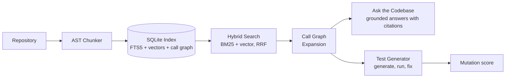
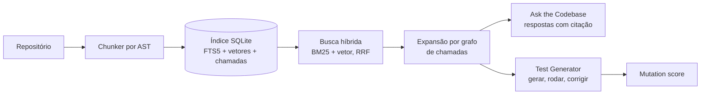

# LegacyLens

CLI and API built to solve two painful problems when stepping into a legacy codebase: **finding where things happen** and **generating tests so you can make changes without fear**. Both rely on the same repository index.

- **Ask the Codebase**: answers questions like "where is payment validation handled?" by pointing to `file:line`. If the retrieved context isn't enough, it admits it doesn't know.
- **Test Generator**: generates `pytest` tests for a given function, runs them, reads the error output, attempts to fix failures, and only saves tests that pass and actually assert behavior.

## Why I built this

Whenever I join an older project, I spend the first few weeks trying to figure out where each business rule lives and what will break if I change a single line. And the safety net that would give me confidence to refactor—tests—usually doesn't exist because nobody writes tests for code they don't understand.

Almost every RAG tutorial out there is about "chatting with a PDF." Code works differently: exact function names, structure, and call hierarchies make all the difference. I wanted to build a tool focused on that—one that could be **measured** in practice rather than just being another pretty demo.

## How it works



1. **AST-based chunking.** Every function and method becomes a separate chunk, while classes become header chunks. No function is ever split down the middle.
2. **Hybrid search.** BM25 (SQLite FTS5) catches exact names and identifiers, while vector embeddings capture semantic intent. Both rankings are merged using *Reciprocal Rank Fusion*, and a lightweight reranker boosts chunks whose names appear in the query.
3. **Structural context.** For top search hits, the system also pulls their callers and callees, tagging those neighbors as `graph`.
4. **Grounded answers.** The prompt enforces citations in `[path:start-end]` format. Once the response comes back, each citation is verified against the actual chunks sent to the model; any mismatch is flagged as invalid.
5. **Tests that actually run.** The model writes the test, `pytest` executes it, and any traceback is fed back to the model to fix (up to N attempts). Tests without any `assert` statements are blocked before execution, and broken files are never left behind in the repository.

More details on architecture and technical decisions can be found in [docs/architecture.md](docs/architecture.md) and [docs/decisions.md](docs/decisions.md).

## Getting started

You need Python 3.10+ and an Anthropic API key (`ANTHROPIC_API_KEY`) to run `ask` and `testgen`. The `index`, `search`, and search evaluation (`eval`) commands run completely offline without an API key.

```bash
pip install -e ".[dev]"

legacylens index /path/to/repository
legacylens search "payment validation" -k 5             # retrieval only, no LLM
legacylens ask "where does validate_payment check the card?"
legacylens testgen "app/payments.py::PaymentService.fee" --mutation
```

With Docker (indexes on startup and exposes the API on port `:8000`):

```bash
REPO=/path/to/repository ANTHROPIC_API_KEY=... docker compose up
curl -s localhost:8000/ask -H 'content-type: application/json' \
     -d '{"question": "where does validate_payment check the card?"}'
```

Environment variable configurations (`LEGACYLENS_MODEL`, `LEGACYLENS_EMBEDDER`, `LEGACYLENS_PRICE_IN`/`_OUT` for cost estimation, etc.) are located in `config.py`.

## Embeddings

By default, the project uses a hashing embedder: it runs offline with zero heavy dependencies, though it doesn't understand semantics or cross-language queries well. It's meant for CI pipelines and unit tests. For real-world usage:

```bash
pip install -e ".[semantic]"
LEGACYLENS_EMBEDDER=st:BAAI/bge-small-en-v1.5 legacylens index .
```

## Results

Methodology and baseline details are in [docs/evaluation.md](docs/evaluation.md). Evaluated repository: *TBD* (I will pin the commit hash and note it here).

| Metric | Value |
| :--- | :--- |
| recall@5, BM25 only | TBD |
| recall@5, vector only | TBD |
| recall@5, hybrid | TBD |
| recall@5, hybrid + graph | TBD |
| Accurate citations in answers | TBD |
| Proper abstention (unanswerable questions) | TBD |
| Tests passing on first attempt | TBD |
| Mutation score: generated vs. human-written | TBD |
| Cost and latency per query | TBD (`.legacylens/telemetry.jsonl`) |

I will publish the real numbers as they come out—including where the system falls short.

## Known limitations

Summary of current constraints (full list in [docs/limitations.md](docs/limitations.md)):

- Currently supports Python only. The chunker uses Python's built-in `ast` module; supporting other languages requires implementing the same interface with `tree-sitter`.
- The call graph matches by function/method name only, without type resolution. Methods sharing the same name across different classes can get mixed up.
- The test runner uses `subprocess` with a timeout—it is not a sandbox. Run inside a container when analyzing untrusted third-party code.
- Vector search performs a brute-force scan in memory: handles tens of thousands of functions fine, but won't scale to millions.
- Mutation scoring relies on `mutmut` 2.x, as CLI output formats change across major versions.

## Project structure

```text
src/legacylens/
  ingest/       AST chunker and repository reader
  retrieval/    hybrid search, RRF, reranker, and graph expansion
  testgen/      execution-backed generation, test runner, and mutation score
  evaluation/   ground truth, recall@k, MRR, and answer quality
  qa.py         grounded Q&A and citation verification
  pr.py         maps git diffs to modified functions
tests/          unit tests (mocked LLM and runner)
docs/           architecture, decisions, evaluation, and limitations
```

## Contributing & License

Check out [CONTRIBUTING.md](CONTRIBUTING.md). Licensed under MIT.

# LegacyLens

CLI e API para resolver dois problemas chatos quando você pega um sistema legado: **achar onde as coisas acontecem** e **criar testes para mexer sem medo**. Os dois usam o mesmo índice do repositório.

- **Ask the Codebase**: responde perguntas como "onde fica a validação de pagamento?" apontando `arquivo:linha`. Se o contexto recuperado não der conta, ele admite que não sabe.
- **Test Generator**: gera testes em `pytest` para uma função, roda, lê o erro, tenta corrigir e só salva o que passar e realmente validar alguma coisa.

## Por que eu fiz isso

Sempre que entro em um projeto antigo, perco as primeiras semanas tentando descobrir onde está cada regra de negócio e o que vai quebrar se eu alterar uma linha. E o que traria segurança para mexer, que são os testes, normalmente não existe porque ninguém escreve teste para código que não entende.

Quase todo tutorial de RAG por aí é sobre "conversar com um PDF". Só que código funciona de outro jeito: nomes exatos de funções, estrutura e quem chama quem fazem toda a diferença. Quis construir uma ferramenta focada nisso e que desse para **medir** na prática, em vez de fazer só mais uma demo bonitinha.

## Como funciona



1. **Chunking por AST.** Cada função e método vira um chunk separado, e classes viram um cabeçalho. Nenhuma função é cortada no meio.
2. **Busca híbrida.** BM25 (SQLite FTS5) pega nomes e identificadores exatos, enquanto os vetores pegam a intenção. Os dois rankings são juntados com *Reciprocal Rank Fusion*, e um reranker simples dá uma força para chunks cujo nome aparece na pergunta.
3. **Contexto estrutural.** Para os melhores resultados, o sistema também puxa quem eles chamam e quem os chama, marcando esses vizinhos como `graph`.
4. **Respostas ancoradas.** O prompt pede citações no formato `[caminho:inicio-fim]`. Depois que a resposta volta, cada citação é conferida contra os trechos que foram realmente enviados; o que não bater entra como inválido.
5. **Testes que rodam de verdade.** O modelo escreve o teste, o `pytest` executa e o traceback volta para o modelo corrigir (até N tentativas). Testes sem nenhum `assert` são barrados antes de rodar, e nenhum arquivo quebrado fica sujando o repositório.

Mais detalhes sobre a arquitetura e as decisões técnicas estão em [docs/architecture.md](docs/architecture.md) e [docs/decisions.md](docs/decisions.md).

## Como rodar

Você precisa de Python 3.10+ e de uma chave da API da Anthropic (`ANTHROPIC_API_KEY`) para rodar `ask` e `testgen`. Os comandos `index`, `search` e a avaliação de busca (`eval`) funcionam offline, sem chave.

```bash
pip install -e ".[dev]"

legacylens index /caminho/do/repositorio
legacylens search "validação de pagamento" -k 5          # só recuperação, sem LLM
legacylens ask "onde validate_payment valida o cartão?"
legacylens testgen "app/payments.py::PaymentService.fee" --mutation
```

Com Docker (indexa ao subir e expõe a API na porta `:8000`):

```bash
REPO=/caminho/do/repositorio ANTHROPIC_API_KEY=... docker compose up
curl -s localhost:8000/ask -H 'content-type: application/json' \
     -d '{"question": "onde validate_payment valida o cartão?"}'
```

Configurações via variáveis de ambiente (`LEGACYLENS_MODEL`, `LEGACYLENS_EMBEDDER`, `LEGACYLENS_PRICE_IN`/`_OUT` para estimar custo, etc.) ficam em `config.py`.

## Embeddings

Por padrão, o projeto usa um embedder por hashing: roda offline e sem instalar nada pesado, mas não entende semântica nem mistura bem português e inglês. Serve para rodar no CI e nos testes. Para usar de verdade:

```bash
pip install -e ".[semantic]"
LEGACYLENS_EMBEDDER=st:BAAI/bge-small-en-v1.5 legacylens index .
```

## Resultados

A metodologia e o baseline estão em [docs/evaluation.md](docs/evaluation.md). Repositório avaliado: *a definir* (vou travar o commit e anotar aqui).

| Métrica | Valor |
| :--- | :--- |
| recall@5, só BM25 | a medir |
| recall@5, só vetor | a medir |
| recall@5, híbrido | a medir |
| recall@5, híbrido + grafo | a medir |
| Citação correta nas respostas | a medir |
| Abstenção correta (pergunta sem resposta) | a medir |
| Testes que passam de primeira | a medir |
| Mutation score: gerados vs. escritos por humanos | a medir |
| Custo e latência por consulta | a medir (`.legacylens/telemetry.jsonl`) |

Vou publicar os números reais como saírem, inclusive onde o sistema mandar mal.

## Limitações conhecidas

Resumo do que ainda pega (lista completa em [docs/limitations.md](docs/limitations.md)):

- Por enquanto só aceita Python. O chunker usa o módulo `ast` nativo; suportar outras linguagens exige implementar a mesma interface usando `tree-sitter`.
- O grafo de chamadas olha só para o nome, sem resolver tipos. Métodos com o mesmo nome em classes diferentes acabam se misturando.
- O executor de testes usa `subprocess` com timeout. Não é um sandbox. Rode dentro de um container se for analisar código de terceiros.
- A busca vetorial faz varredura bruta em memória: aguenta bem dezenas de milhares de funções, mas não escala para milhões.
- O mutation score depende do `mutmut` 2.x, já que o formato de saída muda entre versões.

## Estrutura

```text
src/legacylens/
  ingest/       chunker por AST e leitura do repositório
  retrieval/    busca híbrida, RRF, reranker e expansão por grafo
  testgen/      geração com execução, runner e mutation score
  evaluation/   gabarito, recall@k, MRR e qualidade das respostas
  qa.py         perguntas com citação e checagem de citações
  pr.py         mapeia diff do git para funções alteradas
tests/          testes unitários (LLM e runner simulados)
docs/           arquitetura, decisões, avaliação e limitações
```

## Contribuição e licença

Dá uma olhada em [CONTRIBUTING.md](CONTRIBUTING.md). Licença MIT.

---

Feito por **SEU NOME** ([LinkedIn](https://linkedin.com/in/seu-perfil)).

---

Built by **YOUR NAME** ([LinkedIn](https://linkedin.com/in/your-profile)).
